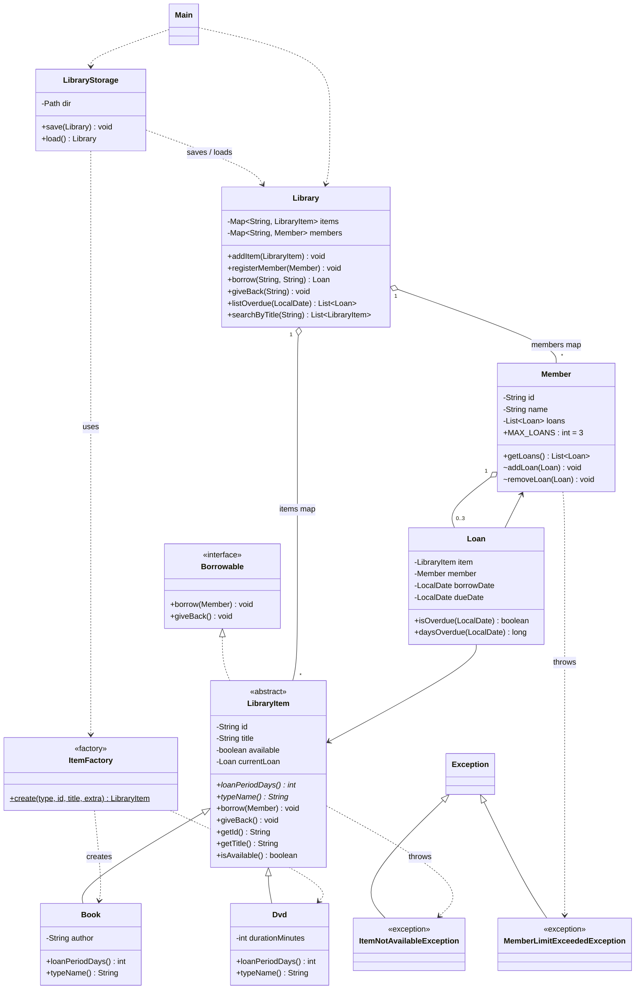

# Lab 11 Mini-Project: Library Management System

**Student:** Lhuzz (Harare Institute of Technology)
**Language:** Java 17+ (console application, default package)

## 1. Overview

A console application that manages books and DVDs, library members and loans. It combines classes, inheritance, an interface, custom exceptions, `Map` collections, streams and CSV file persistence. Data is saved to the `data/` folder on exit and reloaded on start.

## 2. Class diagram

Paste the block below into https://mermaid.live to render or export it as an image for submission.



## 3. How each requirement is met

| # | Requirement | Where / how |
|---|---|---|
| 1 | `Book`, `Member`, `Loan` with private fields, validation, `toString` | All fields are `private`. Constructors reject blank ids/names, non-positive DVD durations and null loan fields. Each class overrides `toString`. |
| 2 | Abstract `LibraryItem`, subclasses with own `loanPeriodDays()` | `LibraryItem` is abstract. `Book` returns 21 days, `Dvd` returns 7 days. |
| 3 | `Borrowable` interface | `borrow(Member)` and `giveBack()`, implemented by `LibraryItem`. `Library` calls them through the interface contract. |
| 4 | Custom exceptions, max 3 loans | `ItemNotAvailableException` (item already on loan) and `MemberLimitExceededException` (`Member.MAX_LOANS = 3`). Both are checked exceptions, so callers must handle them. |
| 5 | `Map<String, ...>` keyed by id | `Library` holds `Map<String, LibraryItem>` and `Map<String, Member>`. |
| 6 | CSV persistence | `LibraryStorage` writes `items.csv`, `members.csv`, `loans.csv` on exit and reads them on start. Titles containing commas or quotes are escaped correctly. Missing files mean first run. Bad rows are skipped with a warning instead of crashing. |
| 7 | Menu | Add item, register member, borrow, return, list overdue, search by title (stream), plus list all and save/exit. |

## 4. OOP principles demonstrated

- **Encapsulation:** private fields everywhere. `Member.getLoans()` returns an unmodifiable view so nobody can bypass the 3-loan limit. State-restoring setters are package-private.
- **Inheritance:** `Book` and `Dvd` extend `LibraryItem` and reuse its id, title, availability and borrow/return logic.
- **Polymorphism:** `Library` and `Loan` work with `LibraryItem` references. `loanPeriodDays()` and `typeName()` resolve to the right subclass at run time, which sets the due date automatically.
- **Abstraction:** `LibraryItem` and `Borrowable` define *what* an item can do. Subclasses and `Library` decide *how*.

## 5. Design pattern and SOLID thinking

- **Factory (Lab 11):** `ItemFactory.create(...)` builds `Book` or `Dvd` from a type string. The menu and the CSV loader depend only on `LibraryItem`. A new item type needs one new subclass and one new `case`, with no other changes (open/closed).
- **Single responsibility:** `Library` enforces business rules, `LibraryStorage` handles files only, `Main` handles user interaction only.
- **Program to an interface:** the `Map`/`List` types are used in declarations and parameters, and items are handled through `Borrowable`/`LibraryItem`.
- **Exception safety:** in `LibraryItem.borrow`, the loan is added to the member first. The item is marked unavailable only if that succeeds, so a rejected 4th loan leaves the item on the shelf.

## 6. Collections and streams

- `Map` lookups give O(1) access by id and detect duplicate ids.
- `searchByTitle`: `filter` (case-insensitive contains), `sorted(Comparator.comparing(...))`, `toList()`.
- `listOverdue`: `flatMap` over every member's loans, `filter(Loan::isOverdue)`, `sorted` by due date.

## 7. Testing

`SelfTest.java` runs 24 plain-Java checks and all pass:

- Loan periods (Book 21, DVD 7) and polymorphic behaviour.
- Double borrow rejected, 4th loan rejected, and the item stays available after the rejection.
- Unknown member/item ids rejected, blank id and zero-minute DVD rejected.
- Return restores availability, double return rejected, member loan count drops.
- Search is case-insensitive and sorted.
- Overdue detection (none today, 2 overdue 30 days ahead).
- CSV round trip: counts, titles with commas/quotes, loan state and due dates preserved, a reloaded loan can be returned, and a first run with no files gives an empty library.

Manual test: running `Main` twice as separate processes confirmed that an item borrowed in run 1 is still "ON LOAN" in run 2, and can be returned and saved again.

## 8. How to run

```
javac *.java
java SelfTest     # automated checks
java Main         # the application (creates data/ on first exit)
```

## 9. Possible extensions

- **Strategy:** swap fine calculation per item type at run time.
- **Observer:** notify members when a reserved item is returned.
- **Singleton:** a shared `AppConfig` for loan limits and the data folder.
